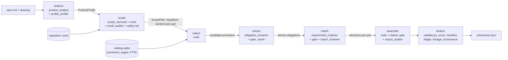

# Architecture

Certivity requirements engine: a component's specification and/or exploded view in, the engineering requirements it must meet under the challenge's UN Regulations out, each cited to regulation, base version, page and paragraph. Specialist LLM agents do the judgment; a plain-Python orchestrator, code gates and reviewer agents keep them honest. How agents are built (rules for prompts, tools, the SDK) is in `AGENTS.md`; the product design is in `Product_Vision/compliance-pipeline/`, and the general, outcome-based funnel this branch implements in `Product_Vision/compliance-pipeline/2026-10-25-general-pipeline.md`.

## Pipeline



The order is fixed code (`app/pipeline/main.py`, `STEPS`); no model decides the path. `RunState` is saved after every step under `data/runs/<run_id>/`, so a run can pause for review (assisted mode, checkpoints after analyze, scope and assemble) and resume.

| Step | Who | What it decides |
|---|---|---|
| analyze | `product_analyst` (judgment tier, vision), checked by `profile_verifier` (fast) | Parts, functions, properties, materials and facts with verbatim quotes. When the spec lists the main parts, those are the parts; unlabelled drawing elements go to `unknowns`. |
| scope | `CERTIVITY_SCOPE_SAMPLES` (default 3) independent `scope_narrower` samples (judgment, high effort, ≤15 corpus tool calls) against one card per regulation, each with `recall_auditor` (review tier) and a full-text safety net; code merges them by vote (`app/matching/scope_vote.py`: regulations and sections kept by 2 of 3) | Applicable / uncertain / not applicable per regulation, and the sections per part: markings, general requirements, sections for the part's own functions, component-level sections, annexes only when they set limits, pass/fail criteria or test levels. |
| collect | code (`app/matching/collect.py`) | Provisions under the chosen sections plus paragraphs they reference, one level deep. A reference to a whole annex adds nothing. |
| extract | `obligation_extractor` (fast tier, medium effort), product-agnostic, cached per provision text and `EXTRACTOR_VERSION` | One obligation per binding clause: list items split, either/or lists kept whole, test-method sentence plus table rows, exceptions kept with their rule, permissions extracted. Each gets a role: outcome, outcome condition, design rule, permission, procedure or administrative. Quotes must be verbatim. |
| match | code drops procedure and administrative roles (recorded as not applicable); `requirement_matcher` and `match_reviewer` (match tier) | Which outcomes bind which parts, by function and behaviour: applicable, uncertain (a design choice the inputs do not settle, kept in the output) or not applicable with one exclusion: other function, other class, other vehicle category, shown absent, presence only. |
| assemble | code, citation gate, `output_auditor` (judgment) | One requirement per obligation, cited to the base version; quote checked on the cited page ±1; duplicates dropped, merged items re-extracted. |
| finalize | code | `tools/validate.py`, offline score, manifest, report, provenance sidecar. |

Every producing agent runs in a bounded verify loop: producer → code gate (schema, ids, quotes) → reviewer, at most 2 retries; disagreement left at the end becomes `uncertain`, never silently dropped (`app/pipeline/loop.py`).

## Models and cost

All calls go through `app/llm.py` (one `AsyncAnthropic` client, budget guard, token and cost log, fake model for tests). Four tiers from the environment: `ANTHROPIC_MODEL` (judgment), `ANTHROPIC_MODEL_FAST` (fast), `ANTHROPIC_MODEL_REVIEW` (review) and `ANTHROPIC_MODEL_MATCH` (matcher and match reviewer; Opus scored best there). `CERTIVITY_COST_MODE=reduced` runs the match reviewer only on disputed batches and skips the extraction verifier.

A dev run (rear lamp, reduced mode) costs $3–6. The budget guard (`CERTIVITY_MAX_COST_USD`) stops a run when spent; set it to 20 for benchmark runs, because a stopped run leaves undecided obligations as uncertain.

## Corpus

`app/corpus/parser.py` turns each regulation text file into page-preserving provisions (`UN R48@9.3.0#6.7.4.1`, `… #Annex 6 Part 4 3`) with kind, heading path, references and page range; `app/corpus/store.py` keeps them in SQLite with FTS5. The store re-parses a file when its text or `PARSER_VERSION` changes. A GTR's rationale (Part I) goes to the Introduction so its numbering restarts at "II. Text of the Regulation". Regulation cards (`data/cards/`, built once by `regulation_profiler` with a grounding check) summarise scope, devices, triggers and device sections for the scope step.

## Traceability (EU AI Act measures)

Each run writes `manifest.json` (inputs, corpus hashes, prompt versions, models), a hash-chained `ledger.jsonl` with the full content of every call, `lineage.json` (product fact → section → provision → obligation → decision) and a provenance sidecar; `certivity verify` replays the submission from the ledger. Benchmark output is labelled an unreviewed AI draft; assisted mode needs a named sign-off.

## Evaluation and the held-out strategy

- Offline: `tools/validate.py`, `tools/score_local.py` (regulation and page level), the funnel in `app/eval/funnel.py`, and `tools/evalkit/` (paragraph-pairing proxy, LLM judge, held-out file checks).
- No generating step reads `expected.json`; `tests/unit/test_fairness.py` fails if expected text reaches a prompt or example.
- A second, independent lane (LLM agents reading the corpus directly) produces its own submission. `tools/evalkit/ensemble.py` combines the two without model calls: keep pipeline requirements whose paragraph the lane also cites, and fill paragraphs the lane cites inside sections the pipeline already covers.
- Ranking metric is requirement-level F2 = 5·matched / (4·expected + submitted): an extra requirement pays when its chance of matching exceeds F2/5, so uncertain requirements are kept.

Dev-case history on the platform (requirement F2): 49.8 % (budget-stopped run) → 59.5 → 65.2 → 71.0 % (pipeline run 3); files and scores in `submissions/dev-rear-lamp/`.

## Layout

```
app/
  llm.py           only module that calls the Anthropic API
  agents/          one AgentSpec + prompt per agent
  pipeline/        orchestrator, verify loop, run state, steps
  gates/           deterministic checks (schema, ids, quotes, citations)
  matching/        case loading, candidates, batches, assembly, citations, submission
  corpus/          parser, SQLite + FTS5 store, cards, obligation cache
  compliance/      ledger, manifest, lineage, oversight, provenance, replay
  eval/            funnel metrics, requirement judge
server/            FastAPI service (SSE, oversight, lineage endpoints)
web/               Astro UI, served by the FastAPI app
tools/evalkit/     scoring, ensemble, held-out checks
submissions/       uploaded and candidate submission files with scores
docs/              AI Act technical file, hackathon runbook and scoreboard
tests/             unit (deterministic) and integration (fake model) tests
```
