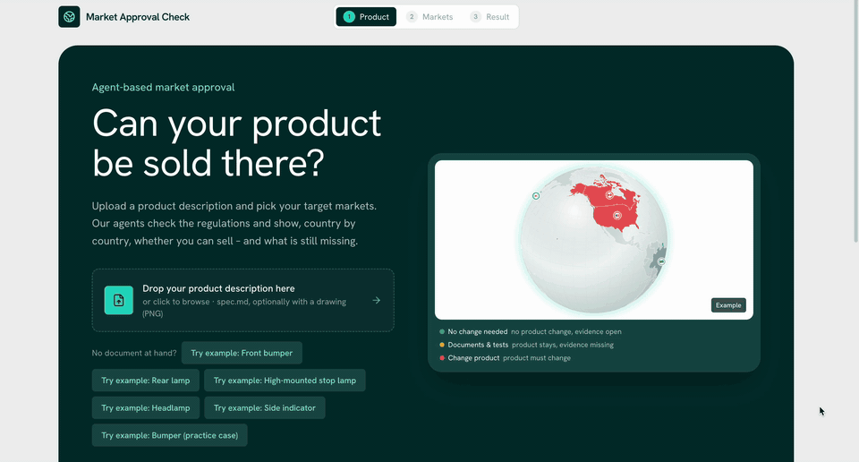
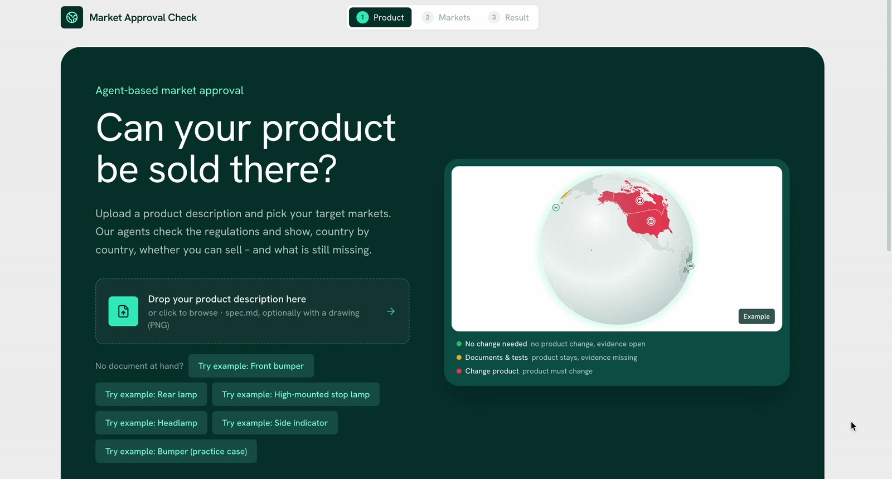
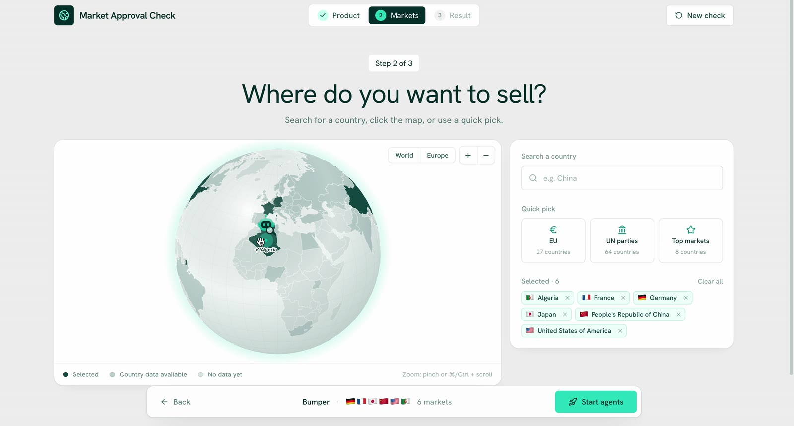
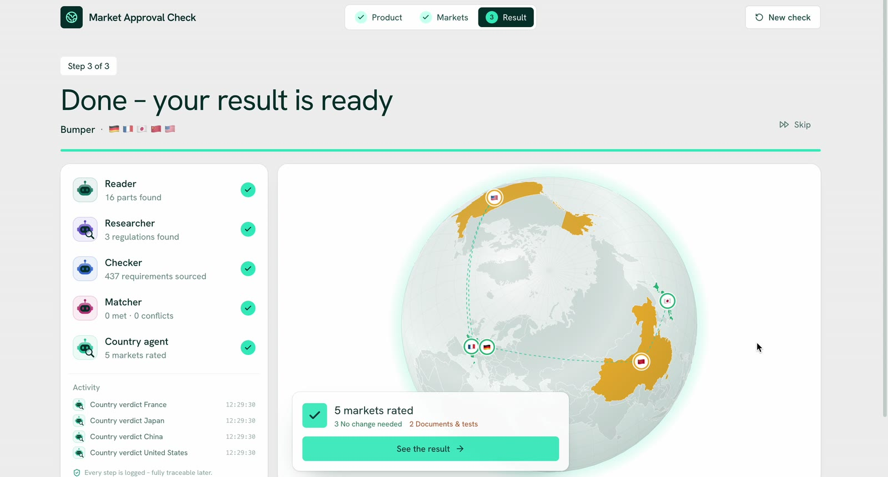
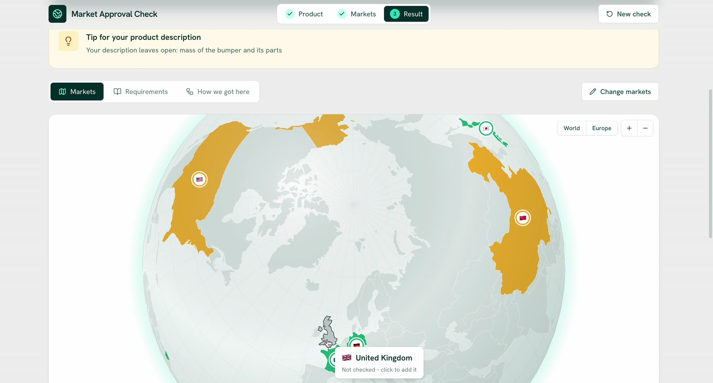
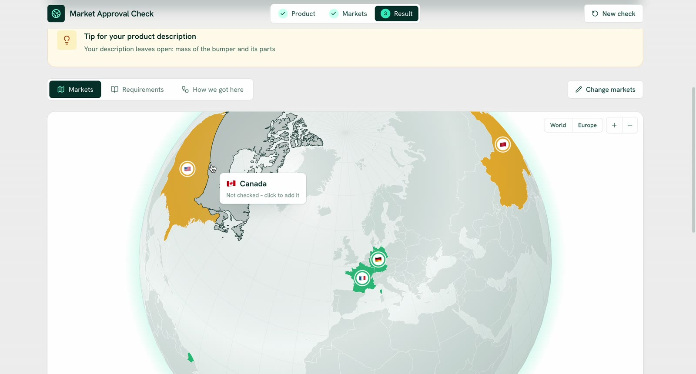
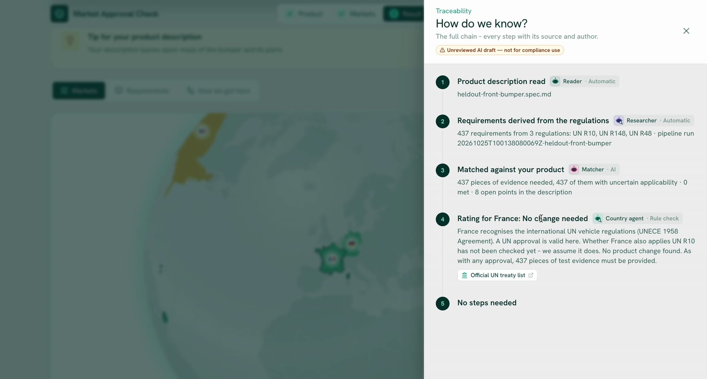
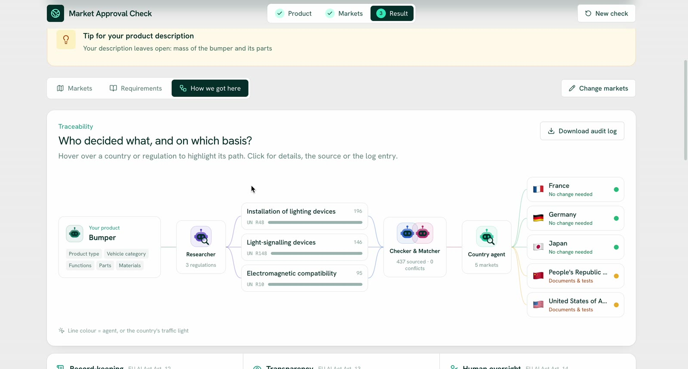
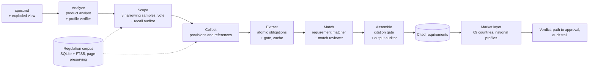

<div align="center">

# Market Approval Check

**Can your product be sold there?** Upload a component specification, pick target markets, and a team of AI agents returns every engineering requirement the product must meet under the UN vehicle regulations, cited to regulation, version and page, plus a per-country verdict and an effort-ranked path to approval.

[](https://github.com/WAMBO5/Butterbrezeln/actions/workflows/ci.yml)


[](docs/media/demo.mp4)

*Two-minute walkthrough: [watch the full demo](docs/media/demo.mp4)*

</div>

---

## Why it matters

Before an automotive supplier can ship a component, its engineers have to establish which regulations apply and what each one demands. For a single rear lamp that means cross-reading UN R48 (122 pages), R148, R10 and their annexes, then repeating the exercise for every market with national rules of its own. It is slow, expert work, and a missed obligation surfaces late, in type approval, when it is most expensive to fix.

| | What the product changes |
| --- | --- |
| **Time to a first draft** | A full analysis of a component runs in about 15 minutes for roughly $5–7 of model usage, instead of an engineer assembling it by hand from hundreds of regulation pages. |
| **Fewer late surprises** | The pipeline is tuned for recall, because a missed requirement costs far more than a reviewed extra one: 88.9 % requirement-level recall and every applicable regulation found on the challenge's worked example. |
| **Market expansion as a decision, not a project** | The same specification is rated for 69 markets. Countries in the UN 1958 Agreement are checked against the UN regulations they actually apply; markets with national rules (USA, China, Brazil, Canada, India) get a concrete gap list, split into *product must change* and *documents and tests missing*, ranked by effort. |
| **Output a compliance team can sign** | Every requirement links to its page, every agent decision is logged in a hash-chained ledger, and nothing counts as reviewed without a named sign-off. The audit trail follows the EU AI Act's record-keeping, transparency and human-oversight articles. |

## Results

Built at the **Industrial Agents Hackathon** (Munich, 24–25 October 2026) on Certivity's challenge: turn a specification and exploded view into the requirements it must fulfil, cited at least to the page.

| Metric (worked example: vehicle rear lamp) | Score |
| --- | --- |
| Requirement-level F2, the ranking metric | **76.9 %** (precision 49.9 %, recall 88.9 %), **#1 on the dev leaderboard** |
| Regulation-level F2 | 1.00: every applicable regulation found |
| Page-level F2 | 0.91 |
| Cost and time per real run | $3–7, about 15 minutes |

The score climbed from 49.8 % to 76.9 % over the event through scope narrowing, extraction and matcher fixes, each measured on the platform ([submission log](approaches/general-approach/submissions/dev-rear-lamp/README.md), [scoreboard](approaches/general-approach/docs/hackathon/scoreboard.md)). No generating step ever reads the reference answer; a fairness test fails the build if reference text reaches a prompt. The rules were calibrated on this example, so the held-out case is the honest test.

## Product tour

<table>
<tr>
<td width="50%"><br><b>1 · Start with the product.</b> Drop a <code>spec.md</code>, optionally with its exploded view, or try one of the example components.</td>
<td width="50%"><br><b>2 · Choose where to sell.</b> Search countries, click the globe or use quick picks (EU, UN 1958 parties, top markets).</td>
</tr>
<tr>
<td><br><b>3 · Watch the agents work.</b> Reader, Researcher, Checker, Matcher and Country agent report live, with an activity log of every decision.</td>
<td><br><b>4 · Read the verdict per market.</b> Green: no product change. Yellow: documents or tests missing. Red: the product itself must change.</td>
</tr>
<tr>
<td><br><b>5 · Follow the path to approval.</b> Each country gets concrete steps ranked by effort; engineers accept or reject every suggestion.</td>
<td><br><b>6 · Ask "how do we know?"</b> Every verdict opens its source chain: spec, regulations, matched requirements, country rule.</td>
</tr>
<tr>
<td colspan="2"><br><b>7 · Audit everything.</b> One graph shows who decided what and on which basis, from the product through each regulation to each market, with a downloadable audit log.</td>
</tr>
</table>

Every result view carries the label *Unreviewed AI draft, not for compliance use* until an engineer signs it off.

## How it works



- **Code orchestrates, agents judge.** The step order, fan-out, retries, validation and budget are plain Python; no model decides the main path. Fourteen specialist agents each have one job.
- **Verify loops everywhere.** Every producing agent runs producer → code gate (schema, ids, verbatim quotes) → reviewer agent, with at most two retries. Disagreement that survives becomes *uncertain* and stays visible; nothing is dropped silently.
- **Citations are checked, not trusted.** Each requirement's quote must appear on its cited page of the regulation, and every submission passes the challenge validator.
- **Traceable and replayable.** Each run writes a manifest, a hash-chained ledger of every model call, per-requirement lineage (product fact → section → provision → obligation → decision) and a provenance sidecar. `certivity verify` replays the output from the ledger.
- **Cost under control.** Model tiers per task, prompt caching, a reduced-cost mode and a hard budget guard per run. A scripted demo model runs the whole product offline for free.

Details: [architecture](approaches/general-approach/ARCHITECTURE.md), [engineering guide](approaches/general-approach/ENGINEERING.md), [design spec](docs/design/compliance-pipeline-design.md), [EU AI Act technical file](approaches/general-approach/docs/ai-act/technical-file.md).

## Run it

Requirements: [uv](https://docs.astral.sh/uv/) (brings Python 3.12), Node 20+, bash (macOS or Linux). An Anthropic API key only for real runs.

The pipeline needs a regulation corpus in `industrial-ai-hackathon/`. Certivity's hackathon package is licensed for the event only and is not part of this repository; [industrial-ai-hackathon/README.md](industrial-ai-hackathon/README.md) describes the layout to drop in.

```bash
cp .env.example .env                                   # set ANTHROPIC_API_KEY for real runs
./certivity general-approach build-corpus              # free, once: parses the regulations into data/
./certivity ui                                         # http://localhost:8010
```

That is enough for **Demo** mode, where a scripted stand-in model writes clearly labelled results for free. For **Real** mode, build the regulation cards once and check the setup:

```bash
CERTIVITY_MAX_COST_USD=8 ./certivity general-approach build-corpus --cards   # about $5, once
./certivity general-approach doctor                                          # key, models, corpus, catalog, cards
```

Then switch the header to *Real*. The switch stays disabled, with the reason, until key, models and corpus are in place; a real run stops at `PIPELINE_MAX_COST_USD` (default $12). The pipeline also runs from the command line:

```bash
./certivity general-approach run ../../testdata/fake-cases/fake-headlamp   # paid; paths are relative to the approach folder
./certivity general-approach score data/runs/<run_id>                      # free
```

Tests run offline, with no API calls:

```bash
./certivity general-approach -- pytest
(cd ui && uv run pytest)
```

## Repository layout

| Path | What |
| --- | --- |
| `ui/` | The product: FastAPI service and React app on one port, plus the curated country data (`ui/data/`) |
| `approaches/general-approach/` | The production pipeline the UI runs: agents, gates, corpus, compliance records, evaluation kit |
| `approaches/main-approach/` | The first iteration of the requirements engine, kept for comparison |
| `industrial-ai-hackathon/` | Validator, local scorer and submission schemas (MIT); drop-in location for the regulation corpus |
| `testdata/fake-cases/` | Synthetic components (headlamp, high-mounted stop lamp, side indicator) |
| `docs/design/` | Design spec, the general pipeline and the precision–recall analysis |
| `docs/media/` | Demo video and screenshots |
| `certivity` | Launcher: `./certivity <approach> <command>` or `./certivity ui` |

Each approach is a self-contained `uv` project with its own README and tests; all of them share one `.env` at the root and keep their data in `data/<approach>/` (git-ignored).

## Team

Built by team **Butterbrezeln**: Wilhelm Pfaffenroth, Konrad Loehr, Mohammad Abdel Aziz and dqnqdon.

The challenge, its regulation corpus and the evaluation platform are by [Certivity](https://certivity.io).
