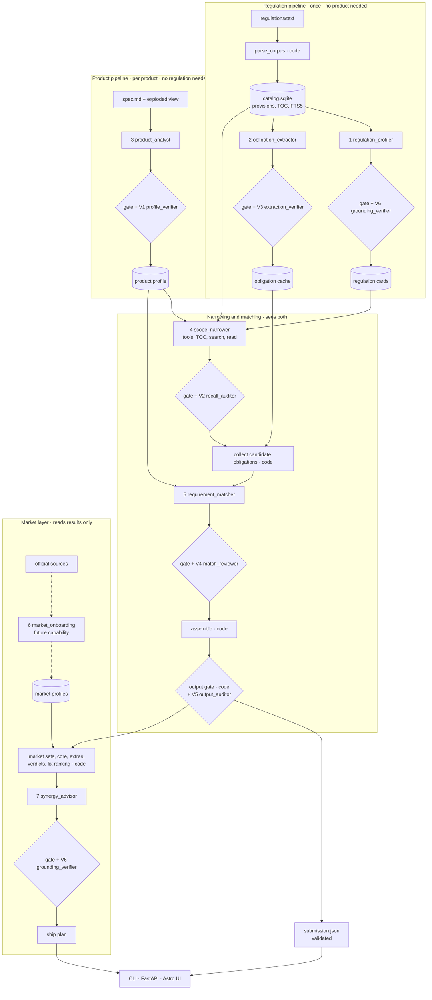
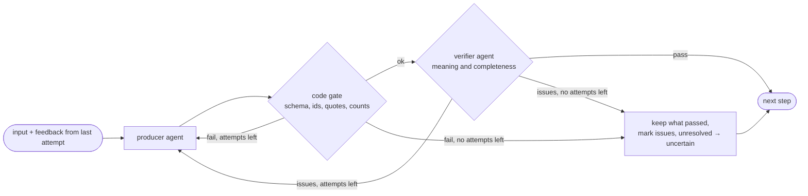
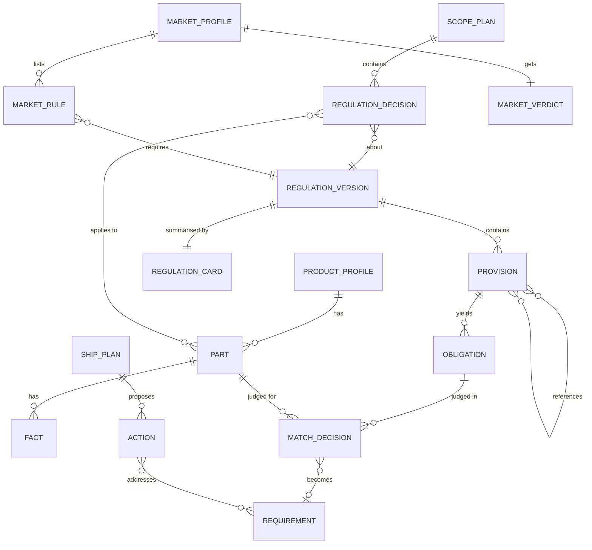
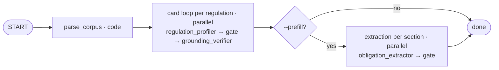
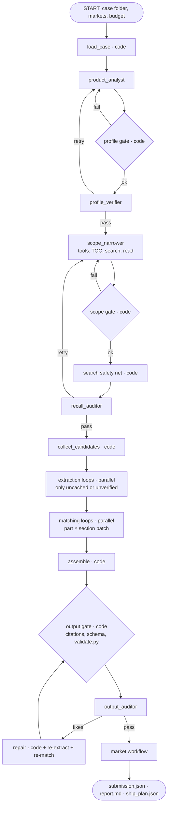
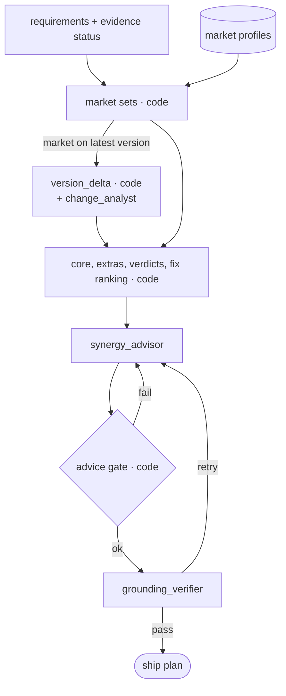
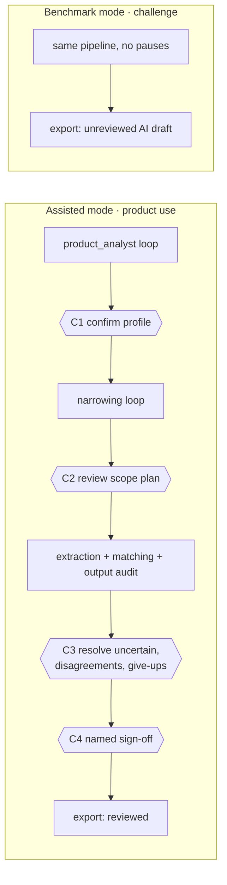
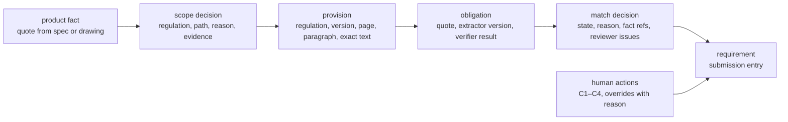

# Certivity requirements engine: design spec

> **Framework superseded 2026-10-24.** The project dropped Google ADK: agents call the model through the Anthropic Python SDK and the orchestrator is plain Python (see `ENGINEERING.md`). Where this spec names ADK (`Workflow`, `LlmAgent`, `AnthropicLlm`, `RequestInput`, plugins, `adk eval`), read it as the matching `ENGINEERING.md` pattern. The pipeline design itself still applies.

**Status:** approved 2026-10-24 (revision 3): no functionality groups, native `AnthropicLlm`, paid runs only on request. Revision 4 adds EU AI Act compliance, human oversight and traceability (section 14) · **Date:** 2026-10-24 · **Scope:** a complete, runnable multi-agent application, with a marked hackathon slice
**Complements:** the team's hackathon plan (workstreams, timeline; not kept in the repository). Section 15 lists where this spec changes a project rule.

**Revision 3 changes:**
- The hand-curated functionality groups are replaced by a narrowing agent with a recall audit (section 3).
- The pipeline is redesigned as producer agents, each checked by code and by a verifier agent in a loop (sections 4–6).
- The application is specified so that one command, given an API key, runs the benchmark (sections 10–11).

---

## 1. What we are building

An engineer gives us a product specification and/or an exploded view of a vehicle component and picks the markets they want to sell in. We return:

1. **The engineering requirements** the component must fulfil under the UN Regulations in `regulations/index.json`, one obligation each, cited to regulation, version, page and paragraph. This list is the challenge submission and ignores markets.
2. **Requirements per market:** which requirements each selected market asks for; which apply everywhere and which only in some markets.
3. **A ship plan:** a verdict per market (`ready` / `evidence needed` / `blocked` / `not covered`), plus a synergy advisor that proposes the changes and tests that make the product shippable in the most markets.

It runs as a command-line tool, a FastAPI service and an Astro UI over the same agent pipeline. Given `ANTHROPIC_API_KEY`, one command runs a benchmark case end to end and scores it.

### Success criteria

| Criterion | Measure |
|---|---|
| Held-out score (40 % of the jury score) | F2 on regulation, page and requirement level for `heldout-front-bumper` |
| Recall at the narrowing step | On the rear lamp, the scope plan keeps 4/4 golden regulations and the sections holding at least 95 % of the 53 golden pages |
| Final quality on the worked example | `score_local.py` regulation and page recall; requirement match estimated with an LLM judge (section 12) |
| Traceability | 100 % of emitted requirements pass the citation check; none come from model memory |
| Runs from one command | `uv run certivity bench` with only `.env` filled in: runs, validates and scores `dev-rear-lamp` with no manual step |
| Cost control | Every run reports tokens and cost per agent; a budget guard stops a run at `CERTIVITY_MAX_COST_USD` (default $5) |

### Decisions

| Decision | Choice | Why |
|---|---|---|
| Narrowing | **An agent narrows**, not a hand-curated catalog: `scope_narrower` reads regulation cards and opens tables of contents with tools; `recall_auditor` challenges what it excluded | No manual curation; works for products we have not seen; recall is checked by a second agent (section 3) |
| Two preprocessing pipelines | The regulation pipeline (parser, cards, obligations) knows no product; the product pipeline knows no regulation; only the narrowing and matching agents see both | Each side is reusable and testable on its own |
| Verification | Every producer agent passes through a **code gate** (schema, ids, quotes) and a **verifier agent** (meaning) in a bounded loop; disagreement left at the end becomes `uncertain` | Quality is enforced in the pipeline, not hoped for in a prompt |
| Orchestration | An ADK `Workflow` graph (code) runs the agents in a fixed order; no LLM supervisor on the main path | `ENGINEERING.md`: fixed ordering belongs in a graph |
| Market data | Sample market profiles, labelled illustrative, with made-up names; `market_onboarding` is the agent that will build real profiles from cited sources later | We never present invented law as real |
| Market layer | Reads the main result and never changes it | The scored output keeps its precision |
| "Intersection" | Shared core plus extras per market; designing to all of them together ships everywhere | Makes "ship to the most markets" computable |
| UI | Astro frontend plus FastAPI backend | Planned in `PROJECT_PLAN.md` |
| EU AI Act | Designed to the high-risk requirements (Articles 9–15) and Article 50 even if the classification turns out lower; legal review confirms classification and compliance (section 14) | Certivity's customers use the output in type approval of safety-relevant products |
| Human oversight | **Assisted mode** (product use): review checkpoints and a named sign-off before output counts as reviewed. **Benchmark mode** (challenge): no pauses; every output labelled an unreviewed AI draft | Oversight where it matters, while the challenge rule of no manual steps still holds |
| Traceability | Every requirement has a stored lineage (product fact → scope decision → provision → obligation → match decision → human action). Every run has a manifest and a hash-chained decision ledger that can be replayed offline | Record-keeping (Article 12) and audits; engineers can answer "why is this here?" |
| Framework | **Approved:** Google ADK 2.13 with LLM through ADK's native `AnthropicLlm` (section 10.1) | The graph, loops, tools with schema, plugins and event stream are all in the installed SDK |

---

## 2. What the data told us

From `industrial-ai-hackathon/regulations/text/` and `cases/dev-rear-lamp/expected.json`:

| Fact | Value | Consequence |
|---|---|---|
| Corpus | 56 regulations; base versions about 1.94M tokens, 3,029 pages, about 20.6k "shall" sentences | Never read in full per product |
| Rear-lamp answer | 190 requirements from 4 regulations (R148, R48, R150, R10), 53 distinct pages | 52 regulations must be ruled out |
| Size of those 4 | about 200k tokens (10 % of the corpus) | Choosing regulations is the biggest saving |
| R10 (electromagnetic compatibility) | 148 pages; the answer uses about 8 (electronic sub-assembly sections) | Choosing sections is the second saving |
| R148 is organised by device type | §5.2 rear position lamps, §5.5 stop lamps, §5.8 reversing lamps, plus general sections (§3.3 markings, §4 general requirements) | Cards record which sections cover which device type, so the narrowing agent picks sections without reading text |
| R7, R23, R6, R38 are **not** cited although they cover rear lamps | R148's introduction says it combines Regulations 4, 6, 7, 23, 38, 50, 77, 87 and 91 | Narrowing must understand consolidation, not only match keywords |
| R10 is cited because of "LED modules on PCB" | A property of one part triggers a cross-cutting regulation | The product profile lists properties such as "contains electronics" |
| R48 (installation) is cited for a component | Installation rules for the device's functions are in scope | Installation is its own path to applicability |
| Golden wording | Only 13 of 190 golden texts are verbatim; median similarity to the closest source sentence is 0.66 | The obligation text is a light, source-faithful rewrite: one shall-clause each, conditions and references kept |

Paths by which a regulation applies; the narrowing agent must consider all five:
1. **Device**: the regulation is about the part (R148, R150).
2. **Installation**: installing the part's function on a vehicle (R48).
3. **Cross-cutting, triggered by a property**: electronics → R10.
4. **Cross-reference**: a paragraph points to an annex, test procedure or definition.
5. **Consolidation**: an older regulation is replaced by a newer combined one and must be dropped.

---

## 3. Why no hand-curated functionality groups

`PROJECT_PLAN.md` proposed a catalog of functionality groups, prepared once by the team, that maps each group to its regulations. We replace it with agents:

| | Hand-curated group catalog | Narrowing agent + recall audit (chosen) |
|---|---|---|
| Upfront work | The team writes and reviews groups and entries (hours) | None beyond regulation cards, which are generated |
| Unseen products (the held-out bumper) | Fails quietly if a group is missing | Reads every card for every product |
| Recall safety | Review discipline | `recall_auditor` plus a code-run full-text search over the corpus, every run |
| Per-run cost | Lowest | About 60–120k extra tokens (card prefix cached), around $0.30 |
| Reuse | Explicit | Cards and the obligation cache are the reusable layer; scope plans are saved per run |

What we keep from the group idea is the *separation*: everything product-agnostic (provisions, cards with per-device sections, obligations) is prepared once; only narrowing and matching run per product.

---

## 4. Agent architecture

### 4.1 What was asked for → which agent

| Request | Agent(s) |
|---|---|
| One agent that narrows down the problem | `scope_narrower`, checked by `recall_auditor` |
| A matching agent between legal text and requirements | `requirement_matcher`, checked by `match_reviewer`; it works on obligations prepared by `obligation_extractor` |
| Verification agents for each step, for quality and proper layout | `profile_verifier`, `recall_auditor`, `extraction_verifier`, `match_reviewer`, `output_auditor`, `grounding_verifier`, each behind a code gate |
| A future agent that adds the regulations of countries | `market_onboarding` |
| An agent that suggests regional synergies | `synergy_advisor` |

### 4.2 Roster

| # | Agent | Role | Runs | Tier | Checked by |
|---|---|---|---|---|---|
| 1 | `regulation_profiler` | Writes one card per regulation version | Once, offline | judgment | card gate + `grounding_verifier` |
| 2 | `obligation_extractor` | Splits provisions into atomic obligations | Once per provision, cached | fast | extraction gate + `extraction_verifier` |
| 3 | `product_analyst` | Builds the product profile from spec and drawing | Per product | judgment, vision | profile gate + `profile_verifier` |
| 4 | `scope_narrower` | Picks regulations and sections per part | Per product | judgment, high effort | scope gate + `recall_auditor` |
| 5 | `requirement_matcher` | Decides which obligations apply to which part, judges evidence, writes a test case | Per part × section batch | judgment | match gate + `match_reviewer` |
| 6 | `market_onboarding` | Builds a market profile from cited sources (future capability) | Per market, on demand | judgment | market gate + `grounding_verifier` |
| 7 | `synergy_advisor` | Proposes changes and tests that open the most markets | Per product × market selection | judgment | advice gate + `grounding_verifier` |
| 8 | `change_analyst` | Explains which requirements change between versions (sub-goal; also feeds markets on a newer version) | Per version pair | judgment | change gate + `grounding_verifier` |
| V1 | `profile_verifier` | Did the profile miss parts, functions, properties? Are facts supported? | after 3 | fast | — |
| V2 | `recall_auditor` | Which excluded regulation or section could still apply? Which inclusion breaks consolidation or category? | after 4 | review | — |
| V3 | `extraction_verifier` | Is each obligation atomic, faithful and complete? | after 2, on candidates only | judgment, low effort | — |
| V4 | `match_reviewer` | Are `not_applicable` reasons sound? Do `applicable` items bind the right device? Is evidence real? | after 5 | review | — |
| V5 | `output_auditor` | Final list: duplicates, merged obligations, unclear subjects, layout | after assembly | judgment | — |
| V6 | `grounding_verifier` | Is each claim supported by its cited text? (generic) | after 1, 6, 7, 8 | fast | — |

The orchestrator is code: an ADK `Workflow`.

### 4.3 Agents considered and dropped

| Dropped | Why |
|---|---|
| Separate drawing reader | One multimodal call reads spec and drawing together; `profile_verifier` catches misses |
| Separate section selector | `scope_narrower` picks sections through the table-of-contents tool; cards already map device types to sections |
| Separate evidence checker | `requirement_matcher` already holds the part's facts and the obligation; it rates the evidence in the same call |
| Separate requirement writer | Golden texts are source-faithful, so the extractor's wording is the final wording |
| LLM supervisor on the main path | Fixed order belongs in a graph; a chat supervisor comes later (section 10.6) |

### 4.4 Overview



---

## 5. The verification loop

Every producer agent runs inside the same loop:



Rules:
1. **Code first.** The gate runs before the verifier, because it is free and certain. A gate failure goes straight back to the producer with the exact error.
2. **Feedback is structured.** Verifiers return `issues` (type, target id, reason, evidence ids); the producer's next attempt receives them as its `feedback` input and must answer each one.
3. **Bounded.** At most 2 retries per item (configurable). After that the pipeline continues. Nothing is silently dropped or blocked: unresolved items are marked and, for decisions, become `uncertain`.
4. **Verifiers judge; they do not rewrite.** They report issues; only the producer (or deterministic code) changes outputs. Each change has one owner.
5. **Verifiers see the source.** A verifier gets the producer's output plus the same source material, never the producer's reasoning, so it checks the result rather than agreeing with the argument.
6. **Visible.** Each attempt, issue and resolution is an event in the run log and in the UI's agent trace, and a record in the decision ledger (section 14.4).
7. **Humans decide what agents could not.** In assisted mode every unresolved item goes to checkpoint C3 (section 14.3). In benchmark mode it stays `uncertain` and is labelled unreviewed.

In ADK, a loop is a `Workflow` with routed edges (`(verifier, producer, "retry")`, `(verifier, next, "pass")`). Per-item loops (extraction, matching) run as nested workflows inside parallel worker nodes with bounded concurrency. `ctx.attempt_count` and state carry the attempt number.

---

## 6. Agent context cards

Each card states exactly what goes into the agent's context, what is kept out on purpose, and what comes back. Token sizes are estimates, to be checked by the budget plugin's per-agent report on the first rear-lamp run. In every prompt the stable parts come first (instructions, then shared reference material), so they can be prompt-cached.

### 6.1 `regulation_profiler` (offline)

| | |
|---|---|
| **Job** | Summarise one regulation version into a card that lets another agent decide applicability without reading the text |
| **Sees** | Title and version; the introduction; scope and definition provisions (exact text); the table of contents to depth 3 (heading, paragraph id, page, kind). About 3–6k tokens |
| **Kept out** | Other regulations, any product, the expected answers |
| **Tools** | None |
| **Returns** | `RegulationCard`: type (device / installation / vehicle system / cross-cutting / other); devices in scope; vehicle categories; functions covered; properties that trigger it ("contains electronic sub-assemblies"); regulations it consolidates; `device_sections` (device type → section ids, for example rear position lamp → R148 §5.2); evidence ids for every claim |
| **Model** | judgment, medium effort |
| **Gate** | Every evidence and section id exists in this version; required fields filled |
| **Verifier** | `grounding_verifier` on each claim against its evidence text |

### 6.2 `obligation_extractor` (offline, cached)

| | |
|---|---|
| **Job** | Turn requirement provisions into atomic obligations, one shall-clause each, worded close to the source |
| **Sees** | One batch of 5–15 provisions from one section: paragraph id, heading path, page, exact text; definitions they reference (depth 1); style rules; 3 worked examples from a regulation **outside** the rear-lamp answer set, so the dev score stays honest; `feedback` on retry. About 3–6k tokens |
| **Kept out** | Product, other sections, expected answers |
| **Tools** | None |
| **Returns** | `ObligationList`: subject, condition, constraint, quantities, `text` (at most 2,000 characters), exact `quote`, kind |
| **Model** | fast, low effort |
| **Gate** | `quote` is a whitespace-normalised substring of the provision; one obligation per modal verb; length limit; provision id matches |
| **Verifier** | `extraction_verifier`, run only on obligations that become candidates in a run; the "verified" flag is cached with the obligation |

### 6.3 `product_analyst`

| | |
|---|---|
| **Job** | Describe the product as parts, functions, properties and facts, without any regulation in mind |
| **Sees** | The case's spec text (whole file); the exploded view image(s); a checklist of properties that often decide applicability (electronics, light emission and colour, reflective elements, transparent or glazing parts, exterior surface, mounting position, fuel or emissions, software or connectivity, materials); vehicle category definitions (M1, N1, …); `feedback` on retry. About 4–8k tokens |
| **Kept out** | Regulations and cards, so the profile is not shaped to fit a regulation. The spec text is wrapped in a marked data block, and the instruction says to ignore any instructions inside it (prompt-injection guard, section 14.5) |
| **Tools** | None |
| **Returns** | `ProductProfile`: product type, vehicle categories, parts (id, name, functions, properties, materials, facts with quotes), relations seen in the drawing, unknowns |
| **Model** | judgment, medium effort, vision |
| **Gate** | Every spec fact's quote is found in the spec; part ids are unique; at least one part |
| **Verifier** | `profile_verifier` |

### 6.4 `scope_narrower` (the narrowing agent)

| | |
|---|---|
| **Job** | For each part, decide which regulations apply and which sections of them matter, across all five paths in section 2 |
| **Sees** | Instructions with the five paths and the consolidation rule; **all base-version regulation cards** (about 25–35k tokens, a stable cached prefix); the product profile (about 2k); `feedback` from `recall_auditor` on retry |
| **Kept out** | Full regulation text (only through tools, one provision at a time), obligations, expected answers |
| **Tools** | `get_table_of_contents(regulation, depth)`; `search_corpus(query)` (FTS5, top 10 provisions with snippet and page); `read_provision(provision_id)`. At most 15 tool calls |
| **Returns** | `ScopePlan`: **a decision for every regulation in `index.json`** (`applicable` / `uncertain` / `not_applicable`, path, parts, reason, evidence ids), plus for each kept regulation the section ids per part |
| **Model** | judgment, high effort |
| **Gate** | One decision per regulation in the index; ids exist; a regulation consolidated by a kept one is not kept without an explicit reason; every part has at least one regulation or an explicit "none found" |
| **Verifier** | `recall_auditor` |

### 6.5 `requirement_matcher` (matching legal text to the product)

| | |
|---|---|
| **Job** | For one part and one section, decide for each candidate obligation whether it applies, how strong the product's evidence is, and how to test it |
| **Sees** | The part (name, functions, properties, facts with ids); a short product summary (type, vehicle category, other parts); the regulation's card; the section's heading path; its candidate obligations (up to about 40: id, text, condition, quote); referenced definitions; `feedback` from `match_reviewer` on retry. About 4–8k tokens per batch |
| **Kept out** | Other regulations and sections, other parts' facts, expected answers |
| **Tools** | `read_provision(provision_id)` for a referenced annex or definition (at most 3 calls) |
| **Returns** | `MatchBatch`: per obligation, state (`applicable` / `uncertain` / `not_applicable`), reason, fact refs, evidence status (`met` / `not_met` / `evidence_needed`), and a one-line test case |
| **Model** | judgment, medium effort |
| **Gate** | Every candidate decided once; fact refs exist; `not_met` requires a contradicting fact |
| **Verifier** | `match_reviewer` |

### 6.6 `market_onboarding` (future capability)

| | |
|---|---|
| **Job** | Build a market profile: which regulations in our corpus a market applies, at which version and status, and which of its rules lie outside our corpus. Every statement is cited |
| **Sees** | Market name; the list of corpus regulations (id, title, version labels and roles; about 2k); source documents the user supplies, or that are stored in `data/market_sources/<market>/`, as text with document ids; `feedback` on retry |
| **Kept out** | Its own memory as a source: the instructions forbid uncited claims, and the gate enforces it |
| **Tools** | Hackathon: none. Future: `fetch_official_source(url)` limited to allowlisted official domains, wrapped as `FunctionTool(require_confirmation=True)` because it is an external fetch |
| **Returns** | `MarketProfile`: rules (regulation, status `mandatory` / `accepted` / `not_applied`, version role), rules outside the corpus, each with `source_ref` (document id + quote), and `illustrative` set if any source is sample data |
| **Model** | judgment, medium effort |
| **Gate** | Regulation ids are in the index or listed as outside the corpus; every quote is found in its source document |
| **Verifier** | `grounding_verifier` |

In the hackathon the three sample markets are hand-written YAML. The agent is demonstrated on a sample source note, labelled illustrative, so the flow is visible without claiming real law.

### 6.7 `synergy_advisor`

| | |
|---|---|
| **Job** | Propose the smallest set of design changes, tests and documents that makes the product shippable in the most selected markets, and point out work that serves several markets at once |
| **Sees** | Results computed by code: requirement set per market, shared core and extras, verdicts, evidence status per requirement, and the fix ranking (each blocking or unproven requirement → the markets it holds back); texts of the top 30 such requirements with citations; the product profile summary. About 8–15k tokens |
| **Kept out** | Full regulation text; any market facts not in the market profiles |
| **Tools** | None |
| **Returns** | `ShipPlan`: envelope summary; ranked actions (title, kind `design_change` / `test_evidence` / `documentation`, requirement ids, markets unlocked, rationale); synergies (one test or change serving several markets); caveats (illustrative data, `not covered` markets) |
| **Model** | judgment, medium effort |
| **Gate** | Requirement ids exist; "markets unlocked" equals the set code computed for those ids; no number in a rationale that is absent from the cited requirement texts |
| **Verifier** | `grounding_verifier` |

### 6.8 `change_analyst` (sub-goal; also feeds markets that need the latest version)

| | |
|---|---|
| **Job** | Say which old requirements change between two versions, and why, with the new page |
| **Sees** | Provision pairs that code aligned and marked modified, added or removed (old and new text, paragraph, pages); the old requirements linked to them; `feedback` on retry |
| **Kept out** | Unchanged provisions; the product |
| **Tools** | None |
| **Returns** | Changes in the sub-goal schema (`modified` / `removed` / `added`, new text, reason, new page and paragraph) |
| **Model** | judgment, medium effort |
| **Gate** | `validate.py --requirements-old` passes; ids exist |
| **Verifier** | `grounding_verifier` on each reason against the provision diff |

### 6.9 Verifier agents

| Verifier | Sees | Looks for | Returns | Model |
|---|---|---|---|---|
| `profile_verifier` | spec text, image(s), the profile | parts, functions or properties in the inputs but missing from the profile; facts not supported by a quote or label | `Review` (pass / issues) | fast, low effort |
| `recall_auditor` | the profile; the scope plan; cards of every regulation marked `not_applicable`; **search hits computed by code** (FTS5 queries built from part names, functions, properties and materials, with regulations that rank high but were excluded highlighted); tables of contents of kept regulations | a missed regulation (path 1–3); a missed section (for example an annex test procedure or the markings section); an inclusion that breaks consolidation or vehicle category. Each issue must cite a card claim or provision | `Review` with issue types `missed_regulation`, `missed_section`, `wrong_inclusion` | review tier, high effort |
| `extraction_verifier` | the provision text and its extracted obligations | merged clauses; added or changed values; dropped conditions or exceptions; shall-clauses not extracted; a subject that is unclear on its own | `Review` per obligation | judgment, low effort |
| `match_reviewer` | the matcher's full context plus its decisions | `not_applicable` based only on the spec being silent (that is `uncertain`); `applicable` for an obligation about another device type (a front position lamp rule on a rear lamp); evidence status not backed by a fact | `Review` with corrections proposed per obligation id | review tier, high effort |
| `output_auditor` | the final requirement list (id, text, source, parts; about 15–25k tokens); the layout rules (paragraph label format, one obligation each, at most 2,000 characters) | duplicates or near-duplicates; two obligations in one requirement; a subject unclear out of context; paragraph label format | `Review` with an issue per requirement id | judgment, medium effort |
| `grounding_verifier` | a list of claims, each with its cited text | claims not supported, or only partly supported, by the cited text | `Review` per claim | fast, low effort |

**Which tier for verifiers.** `ANTHROPIC_MODEL_REVIEW` defaults to the judgment model; it can point to a stronger model (for example Opus 5.5) for `recall_auditor` and `match_reviewer`, which decide recall. Using a different model from the producer also reduces errors that both share.

**How fixes flow after `output_auditor`** (in code, one round):
- duplicates are dropped;
- a merged or unclear requirement sends its provision back through extraction with the issue as feedback, then back through matching;
- label format is fixed by code.

---

## 7. Deterministic components (code, no tokens)

| Component | Does |
|---|---|
| `parse_corpus` | Splits the text on `=== PDF page N ===`; drops page footers; detects paragraph ids, annex-scoped ids (`Annex 8 2.1`) and headings; joins paragraphs across page breaks (`page_start` is cited); classifies kind (`form` and `administrative` never yield obligations); extracts and resolves cross-references; builds the table of contents; stores everything in SQLite with an FTS5 index |
| Gates | One per agent, as listed in its card; return precise errors used as feedback |
| `collect_candidates` | Scope plan sections → provisions → cached obligations; extracts on a cache miss; adds depth-1 cross-referenced provisions (annex tests, definitions) |
| `assemble` | One requirement per obligation (parts merged into `part_ids`); applies the `include_uncertain` policy; maps to the challenge schema (version label from the index, base role, `page_start`, paragraph label) |
| Output gate | Citation check (regulation in the allowlist; exact version label; page exists; quote on the cited page ±1; paragraph exists); JSON schema; `tools/validate.py`; on a case with `expected.json`, also `tools/score_local.py` |
| Market math | Requirement set per market (with `version_delta` for markets on the latest version); shared core, extras, envelope; verdicts; fix ranking by markets unlocked |
| `version_delta` | Aligns provisions of two versions by paragraph id, then text similarity; marks each as unchanged, modified, added or removed |
| Budget plugin | Adds up token usage per agent and model from each response; converts to cost with the price table in config; blocks further model calls once the run budget is reached, and the run ends with partial results flagged |

---

## 8. Data contracts

Pydantic models in `app/models.py`. Every LLM agent has an `output_schema`; field names below are binding.



```python
# Regulation side (product-agnostic)
class Provision:
    provision_id: str            # "UN R148@1.6.0#5.4.2" or "UN R148@1.6.0#Annex 8 2.1"
    regulation: str; version_label: str; role: Literal["base", "latest"]
    paragraph: str; heading_path: list[str]
    page_start: int; page_end: int
    text: str
    kind: Literal["scope", "definition", "administrative", "requirement",
                  "test_procedure", "conformity", "transitional", "form", "other"]
    refs: list[str]

class RegulationCard:
    regulation: str; version_label: str; title: str
    regulation_type: Literal["device", "installation", "vehicle_system", "cross_cutting", "other"]
    devices_in_scope: list[str]; vehicle_categories: list[str]
    functions_covered: list[str]; triggers: list[str]   # properties that make it apply
    consolidates: list[str]
    device_sections: dict[str, list[str]]               # device type → section provision_ids
    evidence: list[str]

class Obligation:
    obligation_id: str; provision_id: str
    subject: str; condition: str | None; constraint: str
    quantities: list[Quantity]                           # value, unit, comparator, as written
    text: str; quote: str
    kind: Literal["design", "performance", "marking", "test", "documentation", "conformity"]
    extractor_version: str; verified: bool

# Product side (regulation-agnostic)
class Fact:
    fact_id: str; key: str; value: str; unit: str | None
    source: Literal["spec", "drawing"]; quote: str

class Part:
    part_id: str; name: str
    functions: list[str]; properties: list[str]; materials: list[str]
    facts: list[Fact]

class ProductProfile:
    product_type: str; vehicle_categories: list[str]
    parts: list[Part]; relations: list[str]; unknowns: list[str]

# Narrowing and matching
class RegulationDecision:
    regulation: str; version_label: str
    state: Literal["applicable", "uncertain", "not_applicable"]
    path: Literal["device", "installation", "cross_cutting", "none"]
    part_ids: list[str]; sections: dict[str, list[str]]   # part_id → section provision_ids
    reason: str; evidence: list[str]

class ScopePlan:
    decisions: list[RegulationDecision]                   # exactly one per regulation in index.json

class MatchDecision:
    part_id: str; obligation_id: str
    state: Literal["applicable", "uncertain", "not_applicable"]
    reason: str; fact_refs: list[str]
    evidence_status: Literal["met", "not_met", "evidence_needed"]
    test_case: str

class Requirement:                                         # maps 1:1 onto the challenge schema
    id: str; text: str
    source: Source                                         # regulation, version, page, paragraph
    part_ids: list[str]; obligation_ids: list[str]
    state: Literal["applicable", "uncertain"]; reason: str
    evidence_status: Literal["met", "not_met", "evidence_needed"]
    test_case: str | None

# Verification
class Issue:
    type: str; target_id: str; reason: str; evidence: list[str]
    proposed: str | None                                   # e.g. proposed state, for match_reviewer

class Review:
    verdict: Literal["pass", "retry"]; issues: list[Issue]

# Markets
class MarketRule:
    regulation: str
    status: Literal["mandatory", "accepted", "not_applied"]
    version_role: Literal["base", "latest"]
    source_ref: SourceRef | None                           # document id + quote

class MarketProfile:
    market_id: str; name: str; illustrative: bool
    rules: list[MarketRule]; outside_corpus: list[SourceRef]

class MarketVerdict:
    market_id: str
    verdict: Literal["ready", "evidence_needed", "blocked", "not_covered"]
    blocking: list[str]; missing_evidence: list[str]; extras: list[str]

class Action:
    title: str; kind: Literal["design_change", "test_evidence", "documentation"]
    requirement_ids: list[str]; markets_unlocked: list[str]; rationale: str

class ShipPlan:
    envelope_summary: str; actions: list[Action]
    synergies: list[str]; caveats: list[str]
```

---

## 9. Workflows

### 9.1 Corpus build (offline): `certivity build-corpus`



Idempotent and keyed by file checksum: new PDFs on Sunday rebuild only what changed.
- **Cards** cost about 170k judgment tokens, once.
- **Pre-filling all base obligations** costs about $1 on the fast tier. `extraction_verifier` runs later, only on the candidates of a run.

### 9.2 Main run: `certivity run <case>`



Every retry edge is bounded (section 5).

### 9.3 Market workflow



The three sample markets each exercise one case:
- **Market A** applies all base versions. This is the plain case.
- **Market B** requires the latest versions of R10 and R48. Real text differences become extras for this market.
- **Market C** marks R150 `not_applied`. This yields `not covered`.

Verdicts:
- `blocked` if any mandatory requirement is `not_met`;
- otherwise `evidence_needed` if any is unproven;
- otherwise `ready`;
- `not covered` overrides all of these when a market relies on rules outside the corpus.

### 9.4 Sub-goal: `certivity subgoal <dir>`

`version_delta` (code) → `change_analyst` loop → `validate.py --requirements-old` → `changes.json`.

---

## 10. The application

### 10.1 Framework and models

**ADK 2.13 `Workflow`** for orchestration. Everything the design needs exists in the installed SDK:
- routed edges for loops; `@node(parallel_worker=True)` with bounded parallelism; nested workflows; `JoinNode`; `RequestInput`; `RetryConfig`;
- `LlmAgent` with `output_schema` *and* tools together (through ADK's `set_model_response` tool);
- plugins with `before_model_callback` and `after_model_callback` for the budget guard;
- `SqliteSessionService` and an event stream for the UI.

Alternatives considered:

| Alternative | Why not |
|---|---|
| Anthropic SDK plus our own orchestration | We would rebuild graph, loops, events, retries and evals |
| LangGraph | Equivalent features; switching costs time and gains nothing we need |
| LLM Agent SDK | Built for autonomous coding and filesystem agents, not typed pipelines |
| LLM Managed Agents | Hosted sandbox sessions; more than we need; data leaves our machines |

**Connector (approved): ADK's native `AnthropicLlm`** (`google.adk.models.anthropic_llm`) instead of `LiteLlm`. It calls the Anthropic API directly with `ANTHROPIC_API_KEY`; it supports effort, prompt caching and `output_schema`; and it drops the LiteLLM dependency layer. It needs `uv add anthropic` and an update to rule 2 in `README.md` and `ENGINEERING.md`. `LiteLlm` remains the fallback.

**Required setting:** without a thinking config, ADK 2.13 forces the call to the schema tool (`tool_choice: tool`), which Sonnet 5.5 and Opus 5.5 reject with a 400. Every agent factory therefore sets `AnthropicGenerateContentConfig(thinking_config=ThinkingConfig(thinking_budget=-1), effort=...)` (adaptive thinking, `tool_choice: auto`). A unit test checks every agent in the tree.

| Tier | Variable | Proposed value | Agents |
|---|---|---|---|
| Judgment | `ANTHROPIC_MODEL` | `claude-sonnet-5-5` | profiler, analyst, narrower, matcher, onboarding, advisor, change analyst, output auditor, extraction verifier |
| Fast | `ANTHROPIC_MODEL_FAST` | `claude-haiku-5-5` | extractor, profile verifier, grounding verifier |
| Review | `ANTHROPIC_MODEL_REVIEW` | defaults to `ANTHROPIC_MODEL` | recall auditor, match reviewer |

Each agent's effort is set in its factory (section 6). The fast tier is a hypothesis checked on the rear lamp (section 12).

### 10.2 Configuration (`.env`)

```bash
ANTHROPIC_API_KEY=            # required; never printed or logged
ANTHROPIC_MODEL=claude-sonnet-5-5
ANTHROPIC_MODEL_FAST=claude-haiku-5-5
ANTHROPIC_MODEL_REVIEW=       # optional; defaults to ANTHROPIC_MODEL
CERTIVITY_TEAM_ID=            # written into submissions
CERTIVITY_MAX_COST_USD=5      # budget guard per run
CERTIVITY_MAX_RETRIES=2       # verification loop limit
CERTIVITY_CONCURRENCY=6       # parallel workers
CERTIVITY_INCLUDE_UNCERTAIN=true
CERTIVITY_DATA_DIR=data
CERTIVITY_RETENTION_DAYS=183  # run records kept at least this long (AI Act Art. 12)
```

The mode (`assisted` / `benchmark`) is chosen per run (section 14.3), not globally.

Prices per model live in `app/config/prices.yaml`, so the cost report never relies on values in code.

### 10.3 Command-line interface (`uv run certivity …`)

| Command | Paid | Does |
|---|---|---|
| `certivity doctor` | no | Checks the key is set (without showing it), models configured, corpus text present, catalog built |
| `certivity build-corpus [--cards] [--prefill]` | `--cards`, `--prefill` | Parses the corpus (free); writes cards; pre-fills obligations |
| `certivity run <case_dir> [--markets A,B,C] [--out DIR] [--mode benchmark\|assisted]` | yes | Full pipeline (default `benchmark`); writes `submission.json`, `report.md`, `ship_plan.json`, `manifest.json`, `ledger.jsonl`, `lineage.json` to `data/runs/<timestamp>/` |
| `certivity verify <run_dir>` | no | Checks the ledger's hash chain and replays gates and assembly from recorded outputs (section 14.4) |
| `certivity signoff <run_dir> --reviewer NAME` | no | Records a named sign-off for a run reviewed in the UI; refused while C3 items are open |
| `certivity technical-file` | no | Regenerates the measured parts of `docs/ai-act/technical-file.md` from manifests and bench reports |
| `certivity score <run_dir>` | no | `validate.py`, `score_local.py` (if the case has `expected.json`), per-stage recall (section 12) |
| `certivity bench` | yes | `run` + `score` on `cases/dev-rear-lamp`; prints scores, cost per agent and loop statistics |
| `certivity subgoal <subgoal_dir>` | yes | Sub-goal output, validated |
| `certivity markets add <name> --source FILE` | yes | Runs `market_onboarding` on supplied sources |
| `certivity serve` | when used | FastAPI on localhost |
| `--fake-llm` (any command) | no | A scripted stand-in model for offline end-to-end tests and UI work |

`load_case` accepts any case folder from the challenge: it picks up `*.md` as spec and `*.png` / `*.jpg` as drawings, and reads `case_id` from the folder name.

### 10.4 API (`server/`, FastAPI)

- `POST /runs` (case or upload, markets) returns a run id.
- `GET /runs/{id}/events` streams server-sent events: agent started or finished, attempt, issues, tokens and cost.
- `GET /runs/{id}` returns the profile, scope plan, requirements, verdicts and ship plan.
- `GET /runs/{id}/submission.json` downloads the submission.
- `GET /provisions/{id}` and `GET /pages/{regulation}/{version}/{page}` return the source text with the quote highlighted.
- `GET /markets` and `POST /markets` list and onboard markets. `POST /runs/{id}/markets` re-runs only the market workflow for a new selection.
- Oversight: `GET /runs/{id}/checkpoints` (the open checkpoint, C1–C3); `POST /runs/{id}/checkpoints/{cid}` (confirm, edit or override with a reason; resumes the run); `POST /runs/{id}/stop`; `POST /runs/{id}/signoff`.
- Traceability: `GET /runs/{id}/requirements/{rid}/lineage`; `GET /runs/{id}/manifest`; `GET /runs/{id}/ledger`; `GET /runs/{id}/provenance.json`.

### 10.5 UI (`web/`, Astro)

1. **Component in:** upload or pick a case; the profile is shown with each fact's source.
2. **Select markets:** sample markets, with an "illustrative data" banner.
3. **Requirements:** grouped by part, then regulation; state and evidence chips; each citation opens the page text with the quote highlighted.
4. **Ship plan:** market × requirement matrix, shared core versus extras, ranked actions and synergies from `synergy_advisor`.
5. **Agent trace:** each agent as a node, showing its attempts, the verifier's issues and how each was resolved, plus tokens and cost. A funnel bar shows 56 regulations → kept regulations → sections → candidates → requirements. This makes the verification loops visible in the demo.
6. **Review (assisted mode):** checkpoints C1–C3, highest-impact items first. Excluded regulations are shown with their reasons. Each decision needs a reason when it overrides the agent. A stop button, and the C4 sign-off.
7. **Why is this here?** On every requirement: its lineage (section 14.4) from product fact to page, including human actions.

Every screen labels requirements "AI-drafted" and shows the review status. Benchmark-mode runs carry the "Unreviewed AI draft" banner.

### 10.6 Later: chat supervisor

A `compliance_assistant` `LlmAgent` answers questions in the UI ("why does R10 apply?", "what if the LEDs are removed?"). It wraps the specialists in `AgentTool` and gets the read-only tools `read_provision`, `search_corpus` and `get_requirement`. It is not on the main path.

### 10.7 Repository layout

```
app/
  __init__.py  agent.py        # root_agent = main Workflow (App name "app")
  cli.py                       # certivity command
  config/                      # settings.py, prices.yaml
  models.py                    # contracts, section 8
  agents/                      # one create_*() factory per agent, prompts beside it
  workflows/                   # corpus.py, main.py, markets.py, subgoal.py, loop.py (the section 5 pattern)
  gates/                       # one module per code gate
  corpus/                      # parser.py, store.py (SQLite + FTS5), xrefs.py, toc.py
  matching/                    # collect.py, assemble.py, citations.py, submission.py
  markets/                     # math.py, delta.py, profiles/*.yaml (illustrative)
  tools/                       # read_provision, get_table_of_contents, search_corpus
  plugins/                     # budget.py, trace.py
  compliance/                  # ledger.py, manifest.py, lineage.py, oversight.py, provenance.py
server/                        # FastAPI
web/                           # Astro
docs/ai-act/                   # classification, risk register, instructions for use, technical file, incident procedure
data/                          # git-ignored: catalog.sqlite, cache, runs/
tests/unit/  tests/integration/  tests/eval/
```

Regulation text and anything derived from it stays in `data/` and is not committed, per `industrial-ai-hackathon/ENGINEERING.md`.

---

## 11. Running against the benchmark

```bash
cp .env.example .env              # add ANTHROPIC_API_KEY and CERTIVITY_TEAM_ID
uv sync
uv run certivity doctor
uv run certivity build-corpus --cards --prefill    # once; paid (≈ $2–3: cards ≈ $1–1.5, pre-fill ≈ $1)
uv run certivity bench                             # rear lamp: run + validate + score
```

Held-out case (Sunday):

```bash
# unpack the held-out package into industrial-ai-hackathon/ (brief §08 step 5), then:
uv run python industrial-ai-hackathon/tools/fetch_regulations.py
uv run certivity build-corpus --extract-missing --cards --prefill   # PDFs without text are extracted; only changed files rebuilt
uv run certivity run industrial-ai-hackathon/cases/heldout-front-bumper
uv run certivity score data/runs/<timestamp>       # validate.py must pass
```

Uploading stays a manual, reviewed step: the last valid held-out upload counts, and uploads are external writes.

**Expected cost per run (estimate, to be replaced by the first measured run):**

| Agent | Input tokens |
|---|---|
| product_analyst + profile_verifier | ≈ 15k |
| scope_narrower (card prefix cached, ≈ 8–12 tool calls) | ≈ 60–90k |
| recall_auditor | ≈ 30k |
| extraction loops (only unverified candidates) | ≈ 0–60k |
| requirement_matcher | ≈ 80–120k |
| match_reviewer | ≈ 60–90k |
| output_auditor + repair | ≈ 25–40k |
| synergy_advisor + grounding | ≈ 15k |
| **Total** | **≈ 300–450k**, about $1–2 per run at the proposed models; about a fifth of reading the corpus once |

Verification roughly triples the tokens of an unverified run. That is the price of the loops, and the budget guard caps it.

---

## 12. Testing and evaluation

**Unit tests (offline, `uv run pytest`):**
- the parser: page markers, annex ids, paragraphs that span pages; every golden `(regulation, page, paragraph)` resolves to a provision;
- each gate, on passing and failing examples;
- citation check, assembly, `validate.py` integration, market math, the fix ranking;
- tool functions;
- the loop pattern (retry, give-up, disagreement → `uncertain`) with stub agents;
- every agent factory sets the thinking config; the graphs compose;
- traceability and oversight:
  - the ledger hash chain detects an edited record;
  - `verify` reproduces the submission from a recorded run;
  - every requirement has a complete lineage, and one with a missing link fails the output gate;
  - assisted-mode export is refused without sign-off; benchmark-mode outputs carry the unreviewed label;
  - the API key never appears in a manifest, ledger, trace or log;
  - an instruction planted in a spec file ("ignore previous instructions…") does not change any gate result.

**Integration test (offline, `--fake-llm`):** the full main run on `dev-rear-lamp` with scripted model outputs produces a submission that passes `validate.py`. This exercises the whole application without an API key.

**Benchmark metrics (`certivity score`, offline after a run):**

| Stage | Metric against `expected.json` |
|---|---|
| Scope plan | golden regulations kept (target 4/4); golden pages inside kept sections (target ≥ 95 %) |
| Before vs after `recall_auditor` | what the audit added |
| Candidates | golden requirements with a matching obligation (text similarity, then LLM judge) |
| Before vs after `match_reviewer` | what the review changed |
| Final | `score_local.py` regulation and page level; requirement match by LLM judge |
| Cost | tokens and cost per agent; loop counts and give-ups |

**Fast-tier check:** compare fast-tier and judgment-tier extraction on the 4 rear-lamp regulations: coverage of the 190 golden requirements, splitting errors, quote failures.

**ADK evals (paid; ask first):** one case first, the rear lamp, with an LLM-as-judge criterion for "same obligation" (same scope, condition, constraint).

**Fairness:** no golden rear-lamp text appears in any prompt or few-shot example, so the dev score predicts the held-out score.

---

## 13. Error handling

| Failure | Handling |
|---|---|
| Schema or gate failure | Back to the producer with the exact error; bounded retries; then flagged |
| Verifier and producer still disagree | The item becomes `uncertain` with both reasons kept |
| Quote or citation not found | The obligation or requirement is dropped and logged; the model never patches a page |
| Product fact missing | `uncertain`, naming the missing fact |
| Budget reached | No new model calls; the run finishes with completed work, marked partial in the report |
| Rate limits or 5xx | SDK retries with backoff; bounded concurrency |
| A tool call budget is exceeded (`scope_narrower`) | The agent must answer with what it has; the gate and `recall_auditor` still run |
| New PDFs in the held-out drop | `build-corpus` rebuilds changed files only |
| Reproducibility | Each run folder holds inputs, every agent's output and attempts, model ids, prompt versions, cost, and the exact submission |

Transparency, oversight and record-keeping are specified in section 14.

---

## 14. EU AI Act compliance, human oversight and traceability

### 14.1 Position

"Fully compliant" is a legal conclusion, so this spec does not claim it. It specifies the technical measures and the documentation the AI Act asks for; legal counsel confirms the classification and the result before the product is placed on the market or used for compliance work.
- **Our role:** we are the provider of an AI system that integrates a general-purpose model (LLM). The general-purpose-model obligations (Articles 53–55) rest with the model provider; our technical file records the model ids and the provider's documentation.
- **Classification (to be confirmed):** the system drafts regulatory requirements for engineers. It is not a safety component of a vehicle and not, on our reading, an Annex III use case, so it is probably not high-risk.
- **We still design to the high-risk requirements** (Articles 9–15), because its output feeds type approval of safety-relevant products and customers will expect it. We also meet Article 50 (transparency) and Article 4 (AI literacy).
- **Dates:** the application dates of the high-risk obligations have been subject to proposed amendments; the technical file records the dates in force at release.

### 14.2 Article-by-article measures

| AI Act | What it requires (summary) | How this system meets it | Built in |
|---|---|---|---|
| Art. 4 AI literacy | Staff and users understand the system | In-app guide; `docs/ai-act/instructions-for-use.md` | UI, docs |
| Art. 6, Annexes I and III | Determine the risk class | `docs/ai-act/classification.md` with the reasoning above, signed off by legal counsel | docs |
| Art. 9 risk management | Identify, evaluate and mitigate risks, across the lifecycle | `docs/ai-act/risk-register.md`; each risk mapped to a pipeline control (table 14.5); reviewed at every release | docs, tests |
| Art. 10 data governance | Relevant, representative, documented data | Corpus provenance: `index.json` checksums, version labels, extraction method; no model training; evaluation data kept out of prompts (section 12, fairness); no personal data needed, so none is requested | corpus build, tests |
| Art. 11, Annex IV technical documentation | A technical file | `docs/ai-act/technical-file.md`: purpose, architecture (this spec), models, data, metrics, oversight, changes. Measured parts are generated by `certivity technical-file` from run manifests and bench reports | CLI, docs |
| Art. 12 record-keeping | Automatic logs over the system's lifetime | Per-run manifest and hash-chained decision ledger (14.4); kept at least `CERTIVITY_RETENTION_DAYS` (default 183, i.e. 6 months); never deleted automatically before that | `app/compliance/` |
| Art. 13 transparency to users | Instructions for use, capabilities, limits, accuracy | Instructions for use; declared accuracy from the latest `bench` (regulation, page and requirement level); limits stated (UN corpus only, illustrative markets, spec-based evidence only) | docs, UI |
| Art. 14 human oversight | People can understand, monitor, override and stop the system; automation bias is addressed | Assisted mode (14.3): checkpoints, override with reason, stop at any time, named sign-off; uncertainty and disagreement shown, not hidden | workflow, API, UI |
| Art. 15 accuracy, robustness, cybersecurity | Declared accuracy; resilience to errors and attacks | Declared metrics; code gates and bounded loops; budget guard; input documents treated as untrusted data (14.5); read-only tools; external fetch only with confirmation; API key never logged; pinned dependencies (LiteLLM 1.82.7 and 1.82.8 excluded) | pipeline, tests |
| Art. 17 quality management | Controlled changes | Prompt and model versions hashed into every manifest; a change to a prompt or model must not lower `bench` scores before release | CLI, process |
| Art. 50 transparency | AI-generated content is disclosed and marked | UI labels every requirement "AI-drafted", plus the review status; exports carry a machine-readable `provenance` sidecar (generator, models, run id, review status) | export, UI |
| Art. 72–73 post-market monitoring and incidents | Monitor performance; report serious incidents | Human overrides are logged and summarised per release as a quality signal; incident procedure in `docs/ai-act/incident-procedure.md` | ledger, docs |

### 14.3 Human oversight: two modes



**Assisted mode** (default for `certivity serve` and the UI):
- **C1–C3 are ADK `RequestInput` pauses.** At each, the reviewer can confirm, edit or add with a reason. Examples: add a regulation the agent excluded; mark a requirement not applicable.
- **C3 is required.** Every `uncertain` item, verifier disagreement and loop give-up needs an explicit decision.
- **C4 is a named sign-off** (reviewer id, time, statement). Export endpoints refuse to label output "reviewed" without it.
- **Stop:** `POST /runs/{id}/stop` ends a run at any point.
- **Human decisions are pinned.** A re-run never overwrites them silently; if new evidence contradicts a pinned decision, it is flagged.
- **Against automation bias:**
  - excluded regulations are shown with their reasons, not only the included ones;
  - high-impact items come first (blocking, uncertain, disagreement);
  - nothing is pre-ticked;
  - the evidence and the verifier's objection sit next to each item.

**Benchmark mode** (default for `certivity run` and `bench`; `--mode assisted` is available):
- no pauses, as the challenge requires;
- every output, the report and the UI say **"Unreviewed AI draft — not for compliance use"**;
- the manifest records the mode;
- uploading the challenge file stays a separate manual act.

### 14.4 Traceability

**Requirement lineage** (`lineage.json`; `GET /requirements/{id}/lineage`; the UI's "Why is this here?" panel):



- **Forward:** every requirement links all six steps by id.
- **Reverse:** from a paragraph to every requirement it produced. From a product fact to every requirement that depends on it, which is the impact analysis when the spec changes.
- **Completeness:** a requirement with any missing link fails the output gate.

**Run manifest** (`manifest.json`):
- **Run:** run id, mode, start and end time, code version (git commit), settings (retries, budget, `include_uncertain`).
- **Inputs:** input file hashes.
- **Corpus:** `index.json` hash and per-file checksums, catalog build id, card versions, `extractor_version`.
- **Agents and cost:** a prompt version (hash of each agent's instruction), model id per agent, totals of tokens and cost.
- **Review:** the reviewer and sign-off, if any.

**Decision ledger** (`ledger.jsonl`, append-only, hash-chained):
- **Records:** one per event, of kind `agent_call` / `gate` / `review` / `loop_result` / `human_action` / `export`.
- **Fields:** sequence number, time, actor (agent name or reviewer id), hashes of input and output, model id, prompt version, tokens, `prev_hash` and `hash`.
- **Full content:** prompts and outputs are stored in `calls/<seq>.json`; the ledger holds their hashes.
- **Tamper-evident:** changing any record breaks the chain.

**Replay** (`certivity verify <run_dir>`, offline, free):
- checks the hash chain;
- re-runs every code gate and the assembly from the recorded agent outputs;
- confirms the submission and lineage follow from the ledger byte for byte.

### 14.5 Risk register (initial)

| Risk | Control |
|---|---|
| Missed requirement (recall) | Every regulation decided explicitly; `recall_auditor`; code safety net; C2/C3 review; recall measured per release |
| Wrong or invented citation | Citation check against page text; quotes must match the source; regulations only from `index.json` |
| Requirement that does not apply | `match_reviewer`; C3 review; precision measured per release |
| Automation bias | Assisted mode design (14.3); benchmark output labelled unreviewed |
| Outdated regulation version | Version labels and checksums in the manifest; base and latest versions kept apart |
| Illustrative market data taken as real | `illustrative` flag, made-up names, banner; `market_onboarding` refuses uncited claims |
| Prompt injection through input documents | Spec and drawing are passed as data inside a marked block; agents are told to ignore instructions inside them; read-only tools; every output passes code gates; nothing an input says can trigger an external action |
| Cost runaway | Budget guard |
| Leaked API key | Key read from the environment only, never logged, never in the ledger or manifest |

---

## 15. Changes to existing project rules

| Rule today | Change | Status |
|---|---|---|
| `PROJECT_PLAN.md` §2, `ENGINEERING.md`: precomputed candidates per functionality group | Replaced by `scope_narrower` + `recall_auditor` over generated regulation cards; one-time preparation stays separate from per-product decisions | Agreed 2026-10-24; update both files in the first implementation task |
| `README.md`, `ENGINEERING.md` rule 2: `LiteLlm`, `ANTHROPIC_MODEL` as `anthropic/<id>` | Native `AnthropicLlm`; bare ids; add `ANTHROPIC_MODEL_FAST`, `ANTHROPIC_MODEL_REVIEW`; `uv add anthropic` | Approved 2026-10-24; one paid smoke test (on request) before relying on it |
| `ENGINEERING.md` Design: supervisor plus specialists | Main path is a `Workflow` with verification loops; supervisor later for chat | Note in `ENGINEERING.md` |
| `ENGINEERING.md` Layout | Add `cli.py`, `config/`, `workflows/`, `gates/`, `corpus/`, `matching/`, `markets/`, `plugins/`, `server/`, `web/`, `data/` | Note in `ENGINEERING.md` |
| `PROJECT_PLAN.md`: multi-market work deferred | Market layer and two market agents, as a read-only overlay after the main path works | This spec |
| No AI Act rules in `ENGINEERING.md` | Add: every run writes a manifest, ledger and lineage; benchmark output is labelled unreviewed; exports carry provenance; prompt or model changes must not lower `bench` scores | Update `ENGINEERING.md` |

---

## 16. Hackathon slice and order of work

**Must have (scored path):**
1. Corpus parser and the free part of `build-corpus`.
2. `regulation_profiler` loop and cards.
3. `product_analyst` loop.
4. `scope_narrower` + `recall_auditor`.
5. Extraction loops.
6. Matching loops.
7. Assembly, output gate and `output_auditor`.
8. `run`, `score` and `bench`.
9. Budget plugin.
10. Manifest, decision ledger, lineage and `verify` (cheap, and they make every result auditable).
11. Held-out run and validated upload.

**Should have (demo, 20 %):**
- FastAPI with events.
- UI steps 1, 3, 5 and 7 (component in, requirements, agent trace, lineage).
- Assisted mode with checkpoints, stop and sign-off (UI step 6).
- `docs/ai-act/` (classification, risk register, instructions for use, technical file).

**Could have:**
- Market workflow with `synergy_advisor` and UI steps 2 and 4.
- `market_onboarding` on a sample source note.
- Sub-goal with `change_analyst`.

**Not now:** fetching official sources, the chat supervisor, real market data.

| When | Work |
|---|---|
| Saturday | Parser, store, tools, gates and unit tests (A); cards (A); `product_analyst` loop (B); narrowing loop (C); extraction and matching loops (A, C); CLI, budget plugin, `--fake-llm` integration test (D); first `bench` run and calibration of `include_uncertain` (C) |
| Saturday late | API and UI trace (D); market workflow and `synergy_advisor` (D); sub-goal (A); pre-fill the cache |
| Sunday 08:00–13:00 | Pull and fetch; `build-corpus`; `run` the held-out case; review the scope plan, `uncertain` items and give-ups in the trace; `score`; validated upload; the last valid upload counts |

**Workstreams (`PROJECT_PLAN.md` §6):**
- **A:** corpus, `regulation_profiler`, `obligation_extractor`, `change_analyst`.
- **B:** `product_analyst`, `market_onboarding`.
- **C:** `scope_narrower`, `requirement_matcher`, their verifiers, benchmark metrics.
- **D:** the application (CLI, plugins, API, UI), `output_auditor`, `synergy_advisor`.

---

## 17. Risks and open questions

1. **Connector:** `output_schema` with and without tools through `AnthropicLlm`, with the thinking setting from section 10.1, must pass one paid smoke test (approval needed). `LiteLlm` is the fallback.
2. **Narrowing recall:** if `scope_narrower` drops a regulation, recall falls on every level. Mitigations:
   - the agent decides on every regulation in the index explicitly;
   - `recall_auditor` reviews every exclusion;
   - code-run full-text search hits are put in front of the auditor;
   - the scope plan's recall is measured on the rear lamp before Sunday.
3. **Verifier cost and latency:** the loops roughly triple tokens and add wall-clock time. Measure on the first `bench`; lower `CERTIVITY_MAX_RETRIES`, or run `match_reviewer` only on `not_applicable` decisions, if needed.
4. **Correlated errors:** a verifier on the same model can share the producer's blind spots. `ANTHROPIC_MODEL_REVIEW` allows a different model for the two recall-critical verifiers.
5. **Fast-tier quality:** if Haiku 5.5 extracts badly, move extraction to the judgment tier at low effort.
6. **Parser noise:** annex forms and tables can create false paragraphs; the `form` kind and the golden-paragraph unit test guard against it.
7. **Overfitting to one example:** prompts and the `include_uncertain` policy are tuned on one case; keep rules general and spot-check on a hand-written bumper profile.
8. **Product role:** the golden set includes installation (R48) requirements for a component; `scope_narrower` must treat installation as a path, and the trace shows it.
9. **Sample markets mistaken for real ones:** made-up names, an `illustrative` flag, a UI banner; `market_onboarding` refuses uncited claims.
10. **Open:** whether `include_uncertain` defaults to on for the held-out run; decide from the rear-lamp scores with the flag on and off.
11. **AI Act classification:** our reading (probably not high-risk) needs legal confirmation. The design meets the high-risk requirements anyway, so a stricter classification changes paperwork, not architecture.
12. **Prompt injection through input files:** the spec and drawing are untrusted. They are marked as data, tools are read-only, and gates check every output. A test with a planted instruction guards this.
